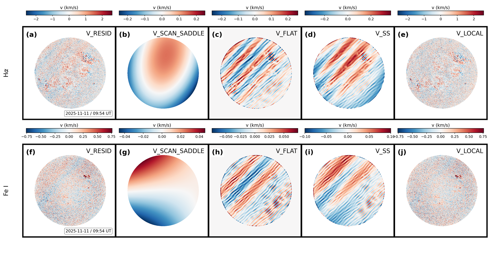
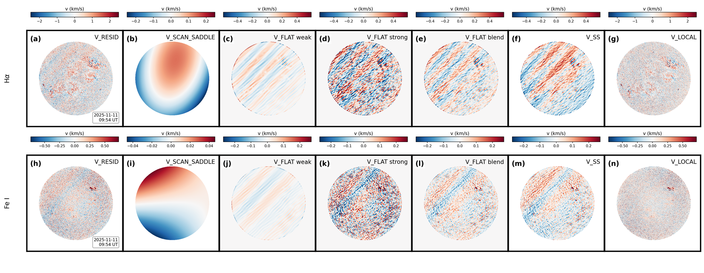

# Solar Chromosphere Velocity Processor

Processing of CHASE/HIS chromospheric spectra into line-of-sight (LOS) velocity
maps, with the large-scale flow modelled, decomposed into its physical
components, and removed.

Version 2.4.0.  The change history is in [`CHANGELOG.md`](CHANGELOG.md); the method
itself is described below and derived in full in the manual.

* Full method write-up (program flow, parallel framework, spectral fitting,
  velocity model, physical meaning and expression of every term):
  **[`docs/manual.pdf`](docs/manual.pdf)** (source: [`docs/manual.tex`](docs/manual.tex),
  rebuild with `latexmk -xelatex docs/manual.tex`;
    example H-alpha and Fe I products are in Section 11).
* Output contract: [`docs/OUTPUT.md`](docs/OUTPUT.md)
* Change history: [`CHANGELOG.md`](CHANGELOG.md)

---

## Contents

- [Overview](#overview)
- [Performance](#performance)
- [Install](#install)
- [Quick start — single machine](#quick-start--single-machine)
  ([one-page version](docs/QUICKSTART.md))
- [Running on a cluster (BlueWhale / LSF)](#running-on-a-cluster-bluewhale--lsf)
- [Python API](#python-api)
- [Method](#method)
  - [Program flow](#program-flow)
  - [Streaming and parallel framework](#streaming-and-parallel-framework)
  - [Spectral line-centre fitting](#spectral-line-centre-fitting)
  - [Doppler inversion](#doppler-inversion)
  - [Velocity model and the physical meaning of each term](#velocity-model-and-the-physical-meaning-of-each-term)
  - [Parameter estimation and uncertainty](#parameter-estimation-and-uncertainty)
- [Output](#output)
- [Scan-saddle and flat-field removal](#scan-saddle-and-flat-field-removal)
- [Joint H-alpha + Fe I figure](#joint-h-alpha--fe-i-figure)
- [Inputs](#inputs)
- [Tests](#tests)
- [License](#license)

---

## Overview

A CHASE/HIS observation is a spectral cube: one spectrum for every position on the
solar disk.  A spectral line forms over a range of heights in the solar atmosphere,
and its displacement from the laboratory wavelength records the line-of-sight
velocity of the plasma at that height, at the moment of observation.  This code
turns such a cube into a velocity map, and separates that map into the
contributions whose origin is known, so that what remains can be attributed to the
solar atmosphere rather than to the geometry of the observation or to the
instrument.

The measurement rests on four steps.

**The line centre is taken from the data.**  A template is built from the average
spectrum near disk centre, every spectrum is cross-correlated with it, and the
displacement of the correlation peak is converted to velocity through the
wavelength scale of the cube.  The result does not depend on the line sitting at
the nominal wavelength of the file.

**The large-scale flow is modelled as a whole rather than subtracted piecewise.**
The observed velocity is described as the sum of the differential rotation, a
centre-to-limb term, the meridional circulation projected along the line of sight
and a global zero point, fitted together over the whole disk.  Each term carries a
physical expression, given in the Method section, and the fit reports which of its
parameters the data can actually constrain.

**What the model leaves is characterised at the scales of the instrument.**  The
fringes and the raster scan-saddle are periodic, parallel, and run to the scale of
the whole image.  They are described by a quadratic surface and by a set of
parallel templates at the wave vectors detected from the map, and those
descriptions are removed.  Active regions are held out of that removal, so the
structure they carry survives it.

**What cannot be measured is reported as such.**  A parameter the model cannot
constrain is flagged and returned with an undefined uncertainty rather than as a
number.

The result is one multi-extension FITS per observation time, one extension per
physical quantity, with figures on request.  The manual derives every step and
lists every keyword written to the header.

## Performance

One full-disk Hα cube, `2313 x 2304 x 118`, one process:

| path | wall time | peak memory |
|---|---|---|
| fringe and scan-saddle removal off (`--no-scan-correction`) | **8.9 s** | 0.79 GB |
| default | **11.4 s** | 1.45 GB |

The removal accounts for 2.5 s and 0.66 GB of that, and is the part of the cost
that buys the fringe characterisation.  The Fe I cube, whose spectra carry 46
planes instead of 118, needs 11.0 s and 1.32 GB.

Where the time goes on the default path:

| stage | cost |
|---|---|
| reading and solar geometry | ~0.6 s |
| Doppler inversion, line centre and cross-correlation | ~6 s |
| active-region mask | ~0.4 s |
| nine-parameter flow fit over 2.4e6 points | ~1.0 s |
| reconstruction, fringe and scan-saddle removal | ~4.6 s |
| writing the product | ~0.5 s |

`--visualize` is not free: the nine figures roughly double the wall time and raise
the peak to about 1.5 GB (3 figures) or 3.0 GB (9 figures).  The FITS product is
written before the figures, so a plotting failure does not cost the product.

For reference, the v1 implementation needed 169 s and 4.27 GB on a comparable
cube (BlueWhale, 64-core `mpi` queue).  The two agree numerically: `VLOS_OBS`
differs by `max|Δ| = 9.5e-7 km/s` (rms `7.5e-8`) and the identifiable parameters
by `max|Δ| = 4.4e-7`; `--legacy` reproduces the v1 numbers.

## Install

```bash
pip install -e .                    # numpy / scipy / astropy must be present
pip install -e '.[all]'             # + matplotlib (figures) and pytest
```

On a cluster without internet, install the compiled dependencies with conda
first and then the package without dependencies:

```bash
conda create -n scv_env -c conda-forge python=3.11 pip numpy scipy astropy \
      matplotlib sunpy
conda activate scv_env
pip install --no-deps -e .
```

## Quick start — single machine

A one-page condensation of this section, written for a first run, is
[`docs/QUICKSTART.md`](docs/QUICKSTART.md).

```bash
# one observation time, complete physics
scv --file RSM20260424T080829_0016_HA.fits --output /data/scv

# a whole directory of level-1 cubes
scv --input /data/level1 --pattern '*_HA.fits' --output /data/scv

# reproduce v1.0.1 exactly (also available as the `process-chase` entry point)
scv --input /data/level1 --output /data/scv --legacy
process-chase -i /data/level1 -o /data/scv            # implies --legacy

# angular rotation rates (rad/s) instead of km/s amplitudes
scv --input /data/level1 --output /data/scv --rotation-amplitude rad_per_s

# fix the limb exponent instead of scanning the grid
scv --input /data/level1 --output /data/scv --limb-exponent 2.0

# with figures: 3 overview panels plus one file per component
scv --input /data/level1 --output /data/scv --visualize --plot-per-component
```

A ready-to-edit wrapper is provided:

```bash
bash examples/run_local.sh /data/level1 /data/scv '*_HA.fits'
```

## Running on a cluster (BlueWhale / LSF)

Two example scripts are provided: `examples/run_bluewhale.sh` is the job body
(runs on the compute node) and `examples/submit_bluewhale.sh` submits it to the
`mpi` queue with the cluster conventions — `-n` a multiple of 64 and
`-R 'span[hosts=1]'` so the job stays on one host.

```bash
# review the exact bsub line, then answer y
bash examples/submit_bluewhale.sh scv-run 01:00
```

Without the CLI, from the directory that holds `src/` and `data/`:

```bash
export PYTHONPATH="$PWD/src:$PYTHONPATH"
mkdir -p work logs

bsub -q mpi -n 64 -W 01:00 -R 'span[hosts=1]' \
     -J scv-run \
     -o logs/scv-run-%J.out -e logs/scv-run-%J.err \
     bash -lc 'cd '"$PWD"' && python -m solar_chromosphere_velocity.cli \
               --input data --pattern "*_HA.fits" --output work \
               --spatial-strip-rows 32 --visualize --log-level INFO'

bjobs                 # watch it
tail -f work/run.log  # the job's own log
```

The analysis is single-threaded by design (see
[Streaming and parallel framework](#streaming-and-parallel-framework)), so use
the cores for **parallel files** rather than inside one file: submit several
jobs, or have the job body loop over disjoint file lists.

## Python API

```python
from solar_chromosphere_velocity import Config, ChromosphereProcessor

cfg = Config(input_dir="/data/level1", output_dir="/data/scv",
             pattern="*_HA.fits", spatial_strip_rows=32)
for r in ChromosphereProcessor(cfg).process_directory():
    print(r.srcfile, r.status, round(r.fit.rms_km_s, 4), r.fit.flags)
    # r.layers holds VLOS_OBS, V_DIFFROT, V_LIMB, V_MERID, V_OFFSET,
    # V_LARGE, V_LOCAL, V_MODEL_ERR, MASK_ACTIVE as numpy arrays
```

Plotting is a thin wrapper around matplotlib and is also importable:

```python
from solar_chromosphere_velocity import plot_from_file, plot_layers

plot_from_file("20260424T080829_HA_scv.fits", "components.png",
               panels=["V_DIFFROT", "V_LIMB", "V_MERID",
                       "V_OFFSET", "V_LARGE", "V_LOCAL"])
```

See [`examples/api_example.py`](examples/api_example.py) for a complete script,
and [`scripts/visualize_layers.py`](scripts/visualize_layers.py) for the
stand-alone figure tool (panel selection, per-component files, shared scales).

## Method

This section summarises [`docs/manual.pdf`](docs/manual.pdf), which gives the
full derivation and the correspondence with the source.

### Program flow

```
level-1 cube ─► read header, build SolarParams
             ─► line-centre fit ─► cross-correlation Doppler inversion
             ─► disk + active-region masks ─► fit sample
             ─► streaming normal equations ─► model parameters
             ─► block-wise reconstruction of every component
             ─► multi-extension FITS + index.csv
             ─► optional multi-panel figures
```

Each stage is timed and reported in `ProcessResult.timings`
(`read+invert`, `invert`, `masks`, `fit`, `reconstruct`, `write`, `plots`,
`total`), which is where the performance table above comes from.

### Streaming and parallel framework

Three layers, in order of what actually buys the speed:

1. **Vectorised solar geometry.** Every pixel of a strip gets its
   `(B, L, rho)` at once, replacing v1's per-pixel Python loop (~59×).
2. **Batched-FFT Doppler inversion.** The cross-correlation of *all* pixels in a
   strip against the reference profile is one FFT call, with the signal axis of
   shape `(window, rows x columns)` (~38×; 24.4 µs → 0.65 µs per pixel on
   synthetic data).
3. **Streaming normal equations.** The fit accumulates an `8 x 8` matrix strip
   by strip, so its memory does not grow with the number of pixels; the
   reconstruction is block-wise too, and only the ten output layers stay
   resident.

The cube is read in strips of `spatial_strip_rows` (default 32) rows using
`hdu.section`, which decodes only the requested tiles. Accessing `hdu.data`
instead would decompress the whole cube (~0.9–1.6 GB, 5–8 s for a 118-layer
file). 32 rows measured fastest *and* leanest against 64/128/256/512.

`parallel_processing` and `parallel_processes` are **reserved**: one file is
already fast, and parallelising across *files* with the scheduler is more
efficient. The in-process path stays single-threaded for reproducibility.

Complexity, with `P` pixels, window length `L = 2w+1` and strip rows `s`:
inversion `O(P L log L)`, fit `O(P · 8²)`, peak memory
`O(s · n_x · L + 10 · n_y · n_x)`.

### Spectral line-centre fitting

The reference profile is the mean profile inside
`reference_profile_radius` pixels of disk centre. The line centre is located by
a Gaussian fit around the local minimum; the wavelength solution

$$\lambda(i) = \mathrm{CRVAL3} + \bigl(i - (\mathrm{CRPIX3}-1)\bigr)\,\mathrm{CDELT3}$$

is used only as a *hint*, because the header solution and the data can disagree
by ~1.4 pixels (~3 km/s) in level-1 files.

### Doppler inversion

With the window centred on the line core, half-width
`w = correlation_half_width`, the reference is `T(j) = Ibar(i0 - w + j)` and each
pixel's window `S_p(j)` is mean-subtracted (`continuum_subtraction`) to remove
the continuum slope. The circular cross-correlation

$$C_p(k) = \sum_{j=0}^{L-1} \tilde S_p(j)\, \tilde T(j-k)$$

is evaluated for the whole strip by FFT. The peak `k*` is refined to sub-pixel
accuracy by the three-point parabola

$$x = \frac{C_p(k^*-1) - C_p(k^*+1)}{2\bigl[C_p(k^*-1) - 2C_p(k^*) + C_p(k^*+1)\bigr]},
\qquad \delta_p = (k^* + x) - \lfloor L/2 \rfloor,$$

with `x` clipped to ±0.5 pixels (`limit_subpixel_shift`). The velocity follows
from the dispersion,

$$\kappa = \frac{c\,\mathrm{CDELT3}}{\lambda_0},
\qquad V_{\mathrm{LOS}}(p) = \delta_p\,\kappa .$$

For Hα (`CDELT3 = 0.04844 Å`, `λ0 = 6562.82 Å`) this gives
`κ ≈ 2.2139 km/s/pixel`. `--legacy` uses v1's hard-coded `1.1068 × 2`
instead. The sign convention is **redshift (receding) positive**, recorded in the
`UNITSYS` card.

### Velocity model and the physical meaning of each term

With `B` the heliographic latitude, `L` the longitude, `rho` the heliocentric
angle and `B0` the disk-centre latitude, define the LOS projections

$$\mathcal{P} = \cos B \sin L \cos B_0, \qquad
\mathcal{M} = \cos L \sin B \cos B_0 - \cos B \sin B_0,$$

then the model LOS velocity is

$$
\begin{aligned}
V_{\mathrm{model}} =\;
& s\bigl(A + B\sin^2 B + C\sin^4 B + D\sin^{10}\rho\bigr)\,\mathcal{P}
   && \text{differential rotation}\\
+\;& e\,(1-\cos\rho)^{N} && \text{limb shift}\\
+\;& \bigl(\mathrm{MC1}\sin B + \mathrm{MC2}\sin 2B\bigr)\,\mathcal{M}
   && \text{meridional circulation}\\
+\;& G && \text{systemic translation}
\end{aligned}
$$

where `s = R_sun` when the rotation parameters are angular rates
(`--rotation-amplitude rad_per_s`), otherwise `s = 1`.

| parameter | physical meaning | expression |
|---|---|---|
| `A` | equatorial rotation amplitude | `s A P` |
| `B` | rotation, `sin²B` term (differential rotation) | `s B sin²B P` |
| `C` | rotation, `sin⁴B` term | `s C sin⁴B P` |
| `D` | rotation, `sin¹⁰rho` limb term | `s D sin¹⁰rho P` |
| `e` | limb-shift amplitude (constrained `>= 0`) | `e (1-cos rho)^N` |
| `N` | limb-shift power-law exponent (grid scan) | `(1-cos rho)^N` |
| `MC1` | meridional circulation, `sin B` component | `MC1 sin B M` |
| `MC2` | meridional circulation, `sin 2B` component | `MC2 sin 2B M` |
| `G` | systemic translational velocity | `G` |

**On `G`.** The inversion template is the disk-centre average profile, so any
absolute (gravitational + convective) line shift is already inside the template.
`G` therefore mixes a true systemic velocity, the template-versus-rest-wavelength
offset and the instrument's absolute wavelength zero point. It is **not** a
gravitational-redshift measurement — for reference, the nominal
`GM/(R_sun c) ≈ 0.636 km/s`, an order of magnitude above the measured `|G|`.

`--legacy` drops the `cos B0` factor, the meridional projection and the `R_sun`
scaling, and takes the velocity scale and line centre the v1 way, so it
reproduces v1.0.1 on the identifiable parameters.

### Parameter estimation and uncertainty

Every parameter except `N` enters linearly, so with the design matrix `X` the
solution satisfies `X'X b = X'y`. The fit accumulates `X'X`, `X'y` and `y'y`
strip by strip and solves a `9 x 9` system; `N` is scanned over
`limb_exponent_scan` re-using the same accumulators, and the minimum-residual
value wins. If `e` comes out negative it is pinned to the boundary by dropping
its column (an active-set step), which necessarily raises the residual sum of
squares — that is the cost of the constraint.

The covariance is `Sigma = s² (X'X)^-1` with `s² = RSS/(n-p)`, and the per-pixel
model uncertainty written to `V_MODEL_ERR` is

$$\sigma_{\mathrm{model}}(x) = \sqrt{x^\top \Sigma x}.$$

A parameter that is not identifiable gets `ERROR = NaN` in the `FITPARAMS`
table, a `FLAG`, and **no** `ERR_*` card — `PINNED_AT_ZERO`,
`DEGENERATE_WITH_E`, `FLAT_SCAN`, `SCAN_GRID`. The covariance itself is left
intact, so `V_MODEL_ERR` stays finite.

## Output

One file per observation time, keyed on the **header** observation time:

```
<output_dir>/<YYYYMMDD>/<YYYYMMDD>T<HHMMSS>_<LINE>_scv.fits
<output_dir>/index.csv
```

The FITS file holds, in order: `PRIMARY`, then one extension per velocity layer
(`VLOS_OBS`, `VLOS_CORR`, `V_DIFFROT`, `V_LIMB`, `V_MERID`, `V_OFFSET`,
`V_LARGE`, `V_LOCAL`, `V_MODEL_ERR`, `MASK_ACTIVE`), then the `FITPARAMS`
binary table. See [`docs/OUTPUT.md`](docs/OUTPUT.md) for the exact card-by-card
contract.

**Outputs are never written next to the inputs.**

## Scan-saddle and flat-field removal

Two systematics survive the nine-parameter flow model, and both
are removed by default before the product is written:

$$V_{SS} = V_{\rm scan\_saddle} + V_{\rm flat}, \qquad
  V_{\rm local} = V_{\rm resid} - V_{SS}$$

**Scan saddle.** A full-disk quadratic fitted by least squares on every finite
pixel, in the normalised disk coordinates `X = (x - xc) / R_sun` and
`Y = (y - yc) / R_sun`:

$$V_{\rm scan\_saddle} = c_0 + c_1 Y + c_2 Y^2 + c_3 X + c_4 XY + c_5 X^2$$

It absorbs the raster scan-saddle and any residual zero-point gradient that the
flow model cannot represent.

**Flat field (stripes).** A parallel-stripe template at wavelength `lambda` and
orientation `theta`, removed either by a Fourier band-stop (Gaussian notch at
`+/- k0` with `sigma = 0.20 k0`, applied through a cosine taper so the disk edge
does not ring) or by an envelope template (demodulate `exp(-i k . r)`, smooth
with `sigma = 80 px`, re-modulate, times two).  The wave vectors are **detected
from the map itself**: local maxima of the 2-D power spectrum with wavelengths
between 30 and 1500 px, limited to those sharing the orientation of the
strongest peak (within 10 degrees), because the fringes are parallel and run to
the scale of the whole image.  Supply
`--stripe-peaks 47.4:108` to pin them instead.  An optional second pass (`--stripe-second-pass`, off by default) re-removes what survived,
triggered by the after/before stripe RMS ratio (above 0.4); it is off by default.

**Active-region protection.** Real blobs must not be erased by the flat field,
so the template is multiplied by a smooth weight

$$W = 1 - s\left(1 - \mathrm{clip}\left(
  \frac{h - \sigma_{|V|}}{h - l}, 0, 1\right)\right)$$

with `l` and `h` the 90th and 99th percentiles of the smoothed absolute velocity
(H-alpha) or the 98th and 99.8th (Fe I), and `s = 1` or `0.6`; the weight is then
smoothed with `sigma = 12 px`.  Where a blob sits, `W` goes to zero and the
stripe term is not removed; in the quiet Sun `W = 1`.

Everything is recorded in `PRIMARY` (`SCANCORR`, `SCSTRIPE`, `SCQUADF`,
`RESSTD`, `SCSTD`, `LOCSTD`, ...), so a product can be audited after the fact.
`--no-scan-correction`, `--no-scan-saddle` and `--no-stripe-removal` switch it
off or partly off.



*The step by step, H-alpha on top and Fe I below: the level-1 residual, the
quadratic, the flat-field stripes, their sum `V_SS`, and the local velocity that
remains.  The fringes are parallel and run at -45 degrees.*



*A hard and a soft arm and the equal-weight blend between them, with the three
flat-field columns on a common scale so the strength difference is readable.*

## Joint H-alpha + Fe I figure

When one run processes both spectral lines, the standard product is **one figure
per observation time**: one row per line, one column per physical component.


Rows are H-alpha and Fe I at the same observing time; columns are `VLOS_OBS`,
`V_DIFFROT`, `V_LIMB + V_MERID + V_OFFSET`, `V_SS` and `V_LOCAL`, so the five
panels of a row read directly as the decomposition of the observed velocity field
and of the systematics removed from it.  The third column sums three small terms
and is therefore an order of magnitude smaller than the others; the view is
derived from `R_SUN` and `CDELT1`, so the framing follows the instrument rather
than one data set.

Produce it during a run over both lines:

```bash
scv --input /data/level1 --pattern '*.fits' --output /data/scv --joint-grid
# -> /data/scv/joint/<YYYYMMDD>T<HHMMSS>_HA_FEI_scv_grid.png, one per time step
```

or from an existing output tree, without re-processing anything:

```bash
python scripts/plot_joint_ha_fe.py /data/scv              # one figure per time
python scripts/plot_joint_ha_fe.py --ha A_HA_scv.fits --fe A_FEI_scv.fits \
    -o figures/joint.png                                  # a single pair
python scripts/plot_joint_ha_fe.py /data/scv --font-scale 1.5 --dpi 150
```

The Python API exposes the same thing:

```python
from solar_chromosphere_velocity import (
    find_joint_pairs, make_joint_series, plot_joint_grid)

plot_joint_grid("A_HA_scv.fits", "A_FEI_scv.fits", "joint.png")
made = make_joint_series("/data/scv")          # {stamp: png}, scans for pairs
pairs = find_joint_pairs("/data/scv")          # [(stamp, ha, fe), ...]
```

Pairing is done on the observation stamp in the file name, because a v2 product
is named `<stamp>_<LINE>_scv.fits`; only stamps that have **both** lines get a
figure, and one is written for every such time step.

## Inputs

* CHASE/HIS level-1 spectral cubes — **RICE_1 compressed** (`CompImageHDU`) or
  plain. The data HDU is found by shape, not by index, and `NAXIS3` may be 118
  (Hα), 46 (Fe I) or anything else.
* Pre-computed 2-D Doppler products in km/s. `BUNIT` is honoured (`m/s` is
  converted); a 2-D map whose `BUNIT` is not a velocity is refused rather than
  silently fitted (`require_velocity_unit`).

## Tests

```bash
SCV_TEST_DATA=/path/to/level1 \
SCV_TEST_UNCOMPRESSED=/path/to/plain_cube.fits \
SCV_TEST_FE=/path/to/fe_cube.fits \
pytest tests -q
```

## License

See [`LICENSE.md`](LICENSE.md).
