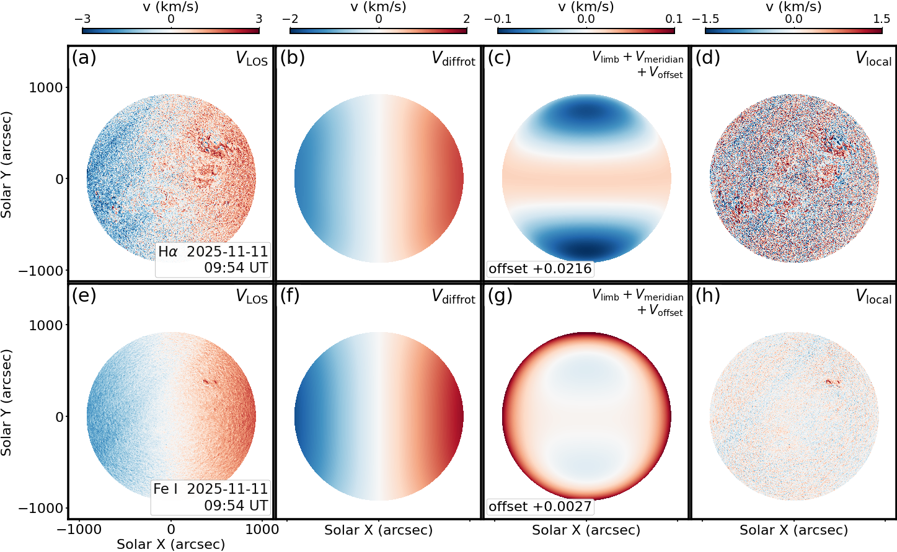

# Solar Chromosphere Velocity Processor

Line-of-sight velocity maps from CHASE/HIS chromospheric spectra.  The large-scale
flow is modelled, split into its physical terms, and removed.

Version 2.4.0.  History in [`CHANGELOG.md`](CHANGELOG.md); the method is derived in
full in the manual.

* **[`docs/manual.pdf`](docs/manual.pdf)**, the full derivation: program flow,
  parallel framework, spectral fitting, velocity model, and the physical meaning
  and expression of every term (source [`docs/manual.tex`](docs/manual.tex),
  rebuild with `latexmk -xelatex docs/manual.tex`).
* Output contract: [`docs/OUTPUT.md`](docs/OUTPUT.md)
* History: [`CHANGELOG.md`](CHANGELOG.md)

---

## Contents

- [Overview](#overview)
- [Performance](#performance)
- [Install](#install)
- [Quick start on a single machine](#quick-start-on-a-single-machine)
  ([one-page version](docs/QUICKSTART.md))
- [Running on a computing cluster](#running-on-a-computing-cluster)
- [Python API](#python-api)
- [Method](#method)
  - [Program flow](#program-flow)
  - [Streaming and parallel framework](#streaming-and-parallel-framework)
  - [Spectral line-centre fitting](#spectral-line-centre-fitting)
  - [Doppler inversion](#doppler-inversion)
  - [Velocity model and the physical meaning of each term](#velocity-model-and-the-physical-meaning-of-each-term)
  - [Parameter estimation and uncertainty](#parameter-estimation-and-uncertainty)
- [Output](#output)
- [Scan-saddle and flat-field removal](#scan-saddle-and-flat-field-removal)
- [Joint H-alpha + Fe I figure](#joint-h-alpha--fe-i-figure)
- [Inputs](#inputs)
- [Tests](#tests)
- [License](#license)

---

## Overview

A CHASE/HIS observation is a spectral cube, one spectrum per position on the disk.
Each line forms over a range of heights, and its displacement from the laboratory
wavelength gives the line-of-sight velocity of the plasma there.  This code turns such a
cube into a velocity map, then splits it into the contributions with a known
origin.  What remains belongs to the atmosphere, not to the observing geometry or
the instrument.

Four steps carry the measurement.

**The line centre is taken from the data.**  A disk-centre template is
cross-correlated with every spectrum; the peak displacement, scaled by the
wavelength dispersion, is the velocity.  The answer never depends on the line
sitting at the file's nominal wavelength.

**The large-scale flow is modelled as a whole.**  Observed velocity is the sum of
differential rotation, a centre-to-limb term, meridional circulation projected
along the line of sight and a global zero point, fitted jointly over the disk.
Each term has a physical expression, given under Method, and the fit reports which
parameters the data can actually constrain.

**What the model leaves is characterised at the scales of the instrument.**
Fringes and the raster scan-saddle are periodic, parallel and image-wide.  A
quadratic surface and a set of parallel templates at wave vectors detected from the
map describe them; both are removed.  Active regions are held out, so the structure
they carry survives.

**What cannot be measured is reported as such.**  A parameter the model cannot
constrain is flagged and returned with an undefined uncertainty, never as a number.

The product is one multi-extension FITS per observation time, one extension per
physical quantity, with figures on request.  The manual derives every step and
lists every header keyword.

## Performance

One full-disk Hα cube, `2313 x 2304 x 118`, one process:

| path | wall time | peak memory |
|---|---|---|
| fringe and scan-saddle removal off (`--no-scan-correction`) | **8.9 s** | 0.79 GB |
| default | **11.4 s** | 1.45 GB |

The removal takes 2.5 s and 0.66 GB of that, and is what buys the fringe
characterisation.  An Fe I cube, 46 planes instead of 118, needs 11.0 s and 1.32 GB.

Where the time goes on the default path:

| stage | cost |
|---|---|
| reading and solar geometry | ~0.6 s |
| Doppler inversion, line centre and cross-correlation | ~6 s |
| active-region mask | ~0.4 s |
| nine-parameter flow fit over 2.4e6 points | ~1.0 s |
| reconstruction, fringe and scan-saddle removal | ~4.6 s |
| writing the product | ~0.5 s |

`--visualize` is not free: nine figures roughly double the wall time and raise the
peak to about 1.5 GB (3 figures) or 3.0 GB (9 figures).  The FITS product is
written first, so a plotting failure costs nothing.

For reference, v1 needed 169 s and 4.27 GB on a comparable cube in a cluster run.
The two agree closely: `VLOS_OBS` to `max|Δ| = 9.5e-7 km/s` (rms `7.5e-8`), the
identifiable parameters to `max|Δ| = 4.4e-7`.  `--legacy` reproduces the v1
numbers.

## Install

```bash
pip install -e .                    # numpy / scipy / astropy must be present
pip install -e '.[all]'             # + matplotlib (figures) and pytest
```

Without internet on a cluster, take the compiled dependencies from conda first,
then the package itself:

```bash
conda create -n scv_env -c conda-forge python=3.11 pip numpy scipy astropy \
      matplotlib sunpy
conda activate scv_env
pip install --no-deps -e .
```

## Quick start on a single machine

A one-page condensation of this section, written for a first run, is
[`docs/QUICKSTART.md`](docs/QUICKSTART.md).

```bash
# one observation time, complete physics
scv --file RSM20260424T080829_0016_HA.fits --output /data/scv

# a whole directory of level-1 cubes
scv --input /data/level1 --pattern '*_HA.fits' --output /data/scv

# reproduce v1.0.1 exactly (also available as the `process-chase` entry point)
scv --input /data/level1 --output /data/scv --legacy
process-chase -i /data/level1 -o /data/scv            # implies --legacy

# angular rotation rates (rad/s) instead of km/s amplitudes
scv --input /data/level1 --output /data/scv --rotation-amplitude rad_per_s

# fix the limb exponent instead of scanning the grid
scv --input /data/level1 --output /data/scv --limb-exponent 2.0

# with figures: 3 overview panels plus one file per component
scv --input /data/level1 --output /data/scv --visualize --plot-per-component
```

A ready-to-edit wrapper is provided:

```bash
bash examples/run_local.sh /data/level1 /data/scv '*_HA.fits'
```

## Running on a computing cluster

Cubes are independent, and one process holds about 1.5 GB.  A cluster is used by
running one process per cube, not by spreading one cube over many cores.

`examples/run_cluster.sh` does exactly that: it takes a data directory, an output
directory, a file pattern and a process count, and keeps that many cubes in
flight.

```bash
bash examples/run_cluster.sh data work '*_HA.fits' 8
```

Hand it to whatever scheduler the cluster provides; it depends on none.  Size the
process count from the node's memory, not its core count.  The observation index is
left to a serial run, since concurrent writers would interleave one file.

Without the CLI, from the directory that holds `src/` and `data/`:

```bash
export PYTHONPATH="$PWD/src:$PYTHONPATH"
python -m solar_chromosphere_velocity.cli \
    --input data --pattern '*_HA.fits' --output work --log-level INFO
```

One cube is single-threaded by design, for the reason under [Streaming and parallel
framework](#streaming-and-parallel-framework): the gains come from vectorising over
the image and streaming the spectral axis.

## Python API

```python
from solar_chromosphere_velocity import Config, ChromosphereProcessor

cfg = Config(input_dir="/data/level1", output_dir="/data/scv",
             pattern="*_HA.fits", spatial_strip_rows=32)
for r in ChromosphereProcessor(cfg).process_directory():
    print(r.srcfile, r.status, round(r.fit.rms_km_s, 4), r.fit.flags)
    # r.layers holds VLOS_OBS, V_DIFFROT, V_LIMB, V_MERID, V_OFFSET,
    # V_LARGE, V_LOCAL, V_MODEL_ERR, MASK_ACTIVE as numpy arrays
```

Plotting is a thin wrapper around matplotlib and is also importable:

```python
from solar_chromosphere_velocity import plot_from_file, plot_layers

plot_from_file("20260424T080829_HA_scv.fits", "components.png",
               panels=["V_DIFFROT", "V_LIMB", "V_MERID",
                       "V_OFFSET", "V_LARGE", "V_LOCAL"])
```

See [`examples/api_example.py`](examples/api_example.py) for a complete script,
and [`scripts/visualize_layers.py`](scripts/visualize_layers.py) for the
stand-alone figure tool (panel selection, per-component files, shared scales).

## Method

This section summarises [`docs/manual.pdf`](docs/manual.pdf), which gives the
full derivation and the correspondence with the source.

### Program flow

```
level-1 cube ─► read header, build SolarParams
             ─► line-centre fit ─► cross-correlation Doppler inversion
             ─► disk + active-region masks ─► fit sample
             ─► streaming normal equations ─► model parameters
             ─► block-wise reconstruction of every component
             ─► multi-extension FITS + index.csv
             ─► optional multi-panel figures
```

`ProcessResult.timings` reports each stage (`read+invert`, `invert`, `masks`, `fit`,
`reconstruct`, `write`, `plots`, `total`); the table above comes from it.

### Streaming and parallel framework

Three layers, in the order they contribute to the speed:

1. **Vectorised solar geometry.** A whole strip gets its `(B, L, rho)` in one call,
   replacing v1's per-pixel Python loop (~59×).
2. **Batched-FFT Doppler inversion.** One FFT correlates the whole strip against the
   reference, signal axis `(window, rows x columns)` (~38×; 24.4 µs → 0.65 µs per
   pixel on synthetic data).
3. **Streaming normal equations.** The fit accumulates an `8 x 8` matrix strip by
   strip, so memory does not grow with pixel count; reconstruction is block-wise
   too, and only the ten output layers stay resident.

Cubes are read in strips of `spatial_strip_rows` (default 32) through
`hdu.section`, which decodes only the requested tiles; `hdu.data` would decompress
the whole cube (~0.9–1.6 GB, 5–8 s for 118 layers).  32 rows measured fastest and
leanest against 64, 128, 256 and 512.

`parallel_processing` and `parallel_processes` are **reserved**.  One file is
already fast, and the scheduler parallelises across files more efficiently.  The
in-process path stays single-threaded for reproducibility.

Complexity, with `P` pixels, window length `L = 2w+1` and strip rows `s`:
inversion `O(P L log L)`, fit `O(P · 8²)`, peak memory
`O(s · n_x · L + 10 · n_y · n_x)`.

### Spectral line-centre fitting

The reference profile is the mean profile within `reference_profile_radius` pixels
of disk centre.  A Gaussian fit around the local minimum fixes the line centre.
The wavelength solution

$$\lambda(i) = \mathrm{CRVAL3} + \bigl(i - (\mathrm{CRPIX3}-1)\bigr)\mathrm{CDELT3}$$

serves only as a *hint*: in level-1 files it departs from the data by up to
~1.4 pixels (~3 km/s).

### Doppler inversion

With the window centred on the line core and half-width `w =
correlation_half_width`, the reference is `T(j) = Ibar(i0 - w + j)`; each pixel's
window `S_p(j)` is mean-subtracted (`continuum_subtraction`) to cancel the
continuum slope.  The circular cross-correlation

$$C_p(k) = \sum_{j=0}^{L-1} \tilde S_p(j) \tilde T(j-k)$$

runs over the whole strip by FFT.  A three-point parabola refines the peak `k*` to
sub-pixel accuracy,

$$
x = \frac{C_p(k^{\ast}-1) - C_p(k^{\ast}+1)}
         {2\bigl[C_p(k^{\ast}-1) - 2C_p(k^{\ast}) + C_p(k^{\ast}+1)\bigr]},
\qquad \delta_p = (k^{\ast} + x) - \lfloor L/2 \rfloor,
$$

with `x` clipped to ±0.5 pixels (`limit_subpixel_shift`).  The dispersion gives the
velocity,

$$\kappa = \frac{c\mathrm{CDELT3}}{\lambda_0},
\qquad V_{\mathrm{LOS}}(p) = \delta_p\kappa .$$

For Hα (`CDELT3 = 0.04844 Å`, `λ0 = 6562.82 Å`) this gives `κ ≈ 2.2139 km/s/pixel`;
`--legacy` keeps v1's hard-coded `1.1068 × 2`.  The sign convention is **redshift
(receding) positive**, recorded in `UNITSYS`.

### Velocity model and the physical meaning of each term

With `B` the heliographic latitude, `L` the longitude, `rho` the heliocentric
angle and `B0` the disk-centre latitude, define the LOS projections

$$\mathcal{P} = \cos B \sin L \cos B_0, \qquad
\mathcal{M} = \cos L \sin B \cos B_0 - \cos B \sin B_0,$$

then the model LOS velocity is

$$
\begin{aligned}
V_{\mathrm{model}} =
& s\bigl(A + B\sin^2 B + C\sin^4 B + D\sin^{10}\rho\bigr)\mathcal{P}
   && \text{differential rotation}\\
+& e(1-\cos\rho)^{N} && \text{limb shift}\\
+& \bigl(\mathrm{MC1}\sin B + \mathrm{MC2}\sin 2B\bigr)\mathcal{M}
   && \text{meridional circulation}\\
+& G && \text{systemic translation}
\end{aligned}
$$

where `s = R_sun` when the rotation parameters are angular rates
(`--rotation-amplitude rad_per_s`), otherwise `s = 1`.

| parameter | physical meaning | expression |
|---|---|---|
| `A` | equatorial rotation amplitude | `s A P` |
| `B` | rotation, `sin²B` term (differential rotation) | `s B sin²B P` |
| `C` | rotation, `sin⁴B` term | `s C sin⁴B P` |
| `D` | rotation, `sin¹⁰rho` limb term | `s D sin¹⁰rho P` |
| `e` | limb-shift amplitude (constrained `>= 0`) | `e (1-cos rho)^N` |
| `N` | limb-shift power-law exponent (grid scan) | `(1-cos rho)^N` |
| `MC1` | meridional circulation, `sin B` component | `MC1 sin B M` |
| `MC2` | meridional circulation, `sin 2B` component | `MC2 sin 2B M` |
| `G` | systemic translational velocity | `G` |

**On `G`.** The template is the disk-centre average profile, so the absolute
(gravitational plus convective) line shift already sits inside it.  `G` therefore
mixes a systemic velocity, the template-versus-rest-wavelength offset and the
instrument's absolute zero point.  It is **not** a gravitational-redshift
measurement: the nominal `GM/(R_sun c) ≈ 0.636 km/s` lies an order of magnitude
above the measured `|G|`.

`--legacy` drops the `cos B0` factor, the meridional projection and the `R_sun`
scaling, and takes the velocity scale and line centre the v1 way, so it
reproduces v1.0.1 on the identifiable parameters.

### Parameter estimation and uncertainty

Every parameter but `N` enters linearly, so with design matrix `X` the solution
satisfies `X'X b = X'y`.  The fit accumulates `X'X`, `X'y` and `y'y` strip by strip
and solves a `9 x 9` system; `N` is scanned over `limb_exponent_scan` on the same
accumulators, and the lowest residual wins.  A negative `e` is pinned by dropping
its column (an active-set step), which raises the residual sum of squares.  That is
the price of the constraint.

The covariance is `Sigma = s² (X'X)^-1` with `s² = RSS/(n-p)`, and the per-pixel
model uncertainty written to `V_MODEL_ERR` is

$$\sigma_{\mathrm{model}}(x) = \sqrt{x^\top \Sigma x}.$$

A parameter that is not identifiable gets `ERROR = NaN` in the `FITPARAMS`
table, a `FLAG`, and **no** `ERR_*` card.  The flags are `PINNED_AT_ZERO`,
`DEGENERATE_WITH_E`, `FLAT_SCAN` and `SCAN_GRID`. The covariance itself is left
intact, so `V_MODEL_ERR` stays finite.

## Output

One file per observation time, keyed on the **header** time:

```
<output_dir>/<YYYYMMDD>/<YYYYMMDD>T<HHMMSS>_<LINE>_scv.fits
<output_dir>/index.csv
```

The FITS file holds, in order: `PRIMARY`, then one extension per velocity layer
(`VLOS_OBS`, `VLOS_CORR`, `V_DIFFROT`, `V_LIMB`, `V_MERID`, `V_OFFSET`,
`V_LARGE`, `V_LOCAL`, `V_MODEL_ERR`, `MASK_ACTIVE`), then the `FITPARAMS`
binary table. See [`docs/OUTPUT.md`](docs/OUTPUT.md) for the exact card-by-card
contract.

**Outputs are never written next to the inputs.**

## Scan-saddle and flat-field removal

Two systematics outlive the nine-parameter flow model, a raster scan-saddle and a set
of parallel fringes.  Both are removed before the product is written:

$$V_{SS} = V_{\rm saddle} + V_{\rm flat}, \qquad
  V_{\rm local} = V_{\rm resid} - V_{SS}$$

**Scan saddle.** A full-disk quadratic, least-squares fitted over every finite pixel
in normalised disk coordinates `X = (x - xc) / R_sun` and `Y = (y - yc) / R_sun`:

$$V_{\rm saddle} = c_0 + c_1 Y + c_2 Y^2 + c_3 X + c_4 XY + c_5 X^2$$

It absorbs the raster scan-saddle and any zero-point gradient the flow model cannot
represent.

**Flat field (stripes).** A parallel-stripe template at wavelength `lambda` and
orientation `theta`, removed by one of two estimators.  The Fourier band-stop
applies a Gaussian notch at `+/- k0` (`sigma = 0.20 k0`) through a cosine taper, so
the disk edge does not ring.  The envelope estimator demodulates `exp(-i k . r)`,
smooths with `sigma = 80 px`, and re-modulates.

The wave vectors are **detected from the map itself**: local maxima of the 2-D
power spectrum between 30 and 1500 px, kept only where they share the orientation
of the strongest peak (within 10 degrees), the fringes being parallel and
image-wide.  `--stripe-peaks 47.4:108` pins them instead.  An optional second pass
(`--stripe-second-pass`) removes what survives, triggered by the after/before
stripe RMS ratio above 0.4.

**A second pass, on the corrected map.**  What one pass leaves along the same
direction is sometimes still visible, most clearly in Fe I.  This code looks
again, on `V_LOCAL` itself, with the search locked to the orientation the first
pass found and the contrast gate raised to forty times the annulus median.  On
the 2026-11-04 cubes that finds 408 px at -45 degrees in H-alpha and 295 px at
-40 degrees in Fe I, at contrasts of 148 and 296, both of which are the wave
vectors an analyst had been choosing by hand.  The gate is what keeps it honest:
a free search on an already corrected map fires at nine to sixteen times the
median on pure noise, so nothing below forty is accepted.  Over four events the
second pass reduces the local velocity by 0 to 2.2 per cent, and does nothing at
all where the first pass already sufficed.  `--no-local-second-pass` turns it off,
`--local-second-pass-contrast` moves the gate.

**Active-region protection.** The flat field must not erase real blobs, so the
template is multiplied by a smooth weight

$$W = 1 - s\left(1 - \mathrm{clip}\left(
  \frac{h - \sigma_{|V|}}{h - l}, 0, 1\right)\right)$$

Here `l` and `h` are the 90th and 99th percentiles of the smoothed absolute velocity
for H-alpha (98th and 99.8th for Fe I), `s` is 1 or 0.6, and the weight is smoothed
with `sigma = 12 px`.  Where a blob sits, `W` goes to zero and the
stripe term is not removed; in the quiet Sun `W = 1`.

Everything is recorded in `PRIMARY` (`SCANCORR`, `SCSTRIPE`, `SCQUADF`,
`RESSTD`, `SCSTD`, `LOCSTD`, ...), so a product can be audited after the fact.
`--no-scan-correction`, `--no-scan-saddle` and `--no-stripe-removal` switch it
off or partly off.

## Joint H-alpha + Fe I figure

A run over both lines gives **one figure per observation time**: a row per line, a
column per physical quantity.



Rows are H-alpha and Fe I at the same observing time; columns are `VLOS_OBS`,
`V_DIFFROT`, `V_LIMB + V_MERID + V_OFFSET`, `V_SS` and `V_LOCAL`, so the five
panels of a row read directly as the decomposition of the observed velocity field
and of the systematics removed from it.  The third column sums three small terms and
is an order of magnitude smaller.  Framing follows `R_SUN` and `CDELT1`, so it suits
any instrument.

Produce it during a run over both lines:

```bash
scv --input /data/level1 --pattern '*.fits' --output /data/scv --joint-grid
# -> /data/scv/joint/<YYYYMMDD>T<HHMMSS>_HA_FEI_scv_grid.png, one per time step
```

or from an existing output tree, without re-processing anything:

```bash
python scripts/plot_joint_ha_fe.py /data/scv              # one figure per time
python scripts/plot_joint_ha_fe.py --ha A_HA_scv.fits --fe A_FEI_scv.fits \
    -o figures/joint.png                                  # a single pair
python scripts/plot_joint_ha_fe.py /data/scv --font-scale 1.5 --dpi 150
```

The Python API exposes the same thing:

```python
from solar_chromosphere_velocity import (
    find_joint_pairs, make_joint_series, plot_joint_grid)

plot_joint_grid("A_HA_scv.fits", "A_FEI_scv.fits", "joint.png")
made = make_joint_series("/data/scv")          # {stamp: png}, scans for pairs
pairs = find_joint_pairs("/data/scv")          # [(stamp, ha, fe), ...]
```

Pairing is done on the observation stamp in the file name, because a v2 product
is named `<stamp>_<LINE>_scv.fits`; only stamps that have **both** lines get a
figure, and one is written for every such time step.

## Inputs

* CHASE/HIS level-1 spectral cubes, **RICE_1 compressed** (`CompImageHDU`) or
  plain.  The data HDU is found by shape, not index, and `NAXIS3` may be 118 (Hα),
  46 (Fe I) or anything else.
* Pre-computed 2-D Doppler products in km/s.  `BUNIT` is honoured (`m/s` is
  converted); a map whose `BUNIT` is not a velocity is refused, not fitted as if it
  were (`require_velocity_unit`).

## Tests

```bash
SCV_TEST_DATA=/path/to/level1 \
SCV_TEST_UNCOMPRESSED=/path/to/plain_cube.fits \
SCV_TEST_FE=/path/to/fe_cube.fits \
pytest tests -q
```

## License

See [`LICENSE.md`](LICENSE.md).
